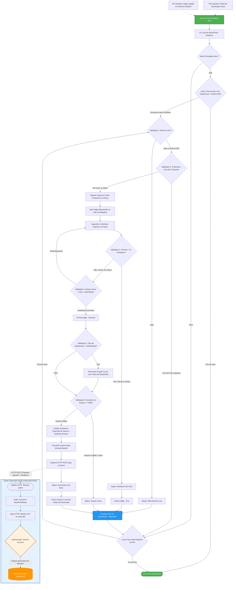

# 🚀 Pipeline de Automação e Ingestão de Relatórios (Power Automate & Microsoft Fabric)

## 📌 Visão Geral e Contexto de Negócio
Este projeto nasceu para resolver um gargalo operacional crítico no setor cooperativo: a extração e o processamento manual de relatórios volumosos a partir de sistemas analíticos internos (SOS e Sisbr Analítico). 

Devido à ausência de uma API direta para integração nativa e ao alto tempo de espera no carregamento manual, a rotina exigia esforço humano repetitivo da equipe. 

**A Solução:** Em conjunto com a equipe, estruturamos agendamentos prévios na plataforma para geração de links diretos de download e criei uma lista centralizada no **SharePoint** para atuar como painel de controle e fila de execução do pipeline. A partir disso, desenvolvi este fluxo automatizado end-to-end que realiza o download em segundo plano, aplica validações rigorosas de integridade e ingere os dados diretamente no **Lakehouse do Microsoft Fabric (OneLake)**.

---

## 🏗️ Arquitetura do Fluxo (Versão 2.0)
O diagrama abaixo representa toda a lógica de decisão, resiliência e integração entre o **Power Automate Desktop (PAD)** e a nuvem (**Power Automate Cloud + Microsoft Fabric**):

> 🔒 **Nota de Segurança e Governança (InfoSec):** Por boas práticas de segurança da informação e conformidade corporativa, o script bruto da automação (que contém endpoints privados, credenciais de contas de serviço e parâmetros internos) não é disponibilizado publicamente. A documentação foca no desenho de arquitetura, engenharia de fluxo e regras de negócio.

---

## ⚙️ Principais Regras de Negócio e Tratamento de Erros
1. **Orquestração via SharePoint:** Uma lista controla quais relatórios estão ativos, a periodicidade e o status em tempo real de cada execução.
2. **Modo Prioridade (`EXECUTAR`):** Permite furar a fila padrão caso um analista precise rodar um relatório específico com urgência.
3. **Camadas de Resiliência:**
   * **Controle de Janela Temporal:** Valida se relatórios mensais estão no dia correto de execução (ex: 2ª quarta-feira do mês).
   * **Prevenção de Loop Infinito (Timeout):** Monitora a pasta de downloads com limite de 12 tentativas e verifica extensões temporárias (`.crdownload`) antes de prosseguir.
   * **Validação de Integridade (<= 6KB):** Descarta arquivos vazios ou corrompidos gerados por falhas na origem.
4. **Sanitização e Ingestão Moderna (Lakehouse):** Limpa caracteres especiais, converte o arquivo para `Base64`, envia via `HTTP POST` para o Power Automate Cloud, converte em binário (`base64ToBinary`) e grava via `HTTP PUT` diretamente no **Microsoft Fabric (OneLake)**.

---

## 🛠️ Tecnologias Utilizadas
* **RPA & Orquestração:** Power Automate Desktop (PAD) & Power Automate Cloud
* **Arquitetura de Dados:** Microsoft Fabric (OneLake / Lakehouse)
* **Controle de Fila & Logs:** SharePoint Lists
* **Integração & Protocolos:** APIs REST (HTTP POST / PUT), JSON, Codificação Base64

---

## 📈 Evolução do Projeto (Changelog & Roadmap)

* **Versão 1.0 (MVP):** Automação inicial focada apenas no download local via links pré-agendados para eliminar a espera manual da equipe.
* **Versão 2.0 (Atual):** Inclusão da fila de controle no SharePoint, modo de prioridade, 6 camadas de validação de erros (timeout, tamanho mínimo, sanitização de nomes) e ingestão direta no Lakehouse do Microsoft Fabric.
* **Versão 3.0 (Roadmap Futuro):**
  * 📧 **Expansão de Fontes:** Automatizar relatórios que atualmente chegam via e-mail, permitindo que a equipe escolha salvar o destino final tanto no SharePoint quanto no Microsoft Fabric.
  * ⚡ **Execução On-Demand Assistida (Runtime):** Implementar um gatilho interativo onde o colaborador solicita a subida de um relatório específico, o fluxo valida a abertura do sistema na máquina, solicita aprovação rápida e executa a ingestão na hora.

---

## 👨‍💻 Autor
Desenvolvido por **Vilton Brito**  
*Data Analyst & Automation Specialist*  
- 💼 [LinkedIn](https://www.linkedin.com/in/vilton-brito-a2128520b/)  
- 📧 [viltonprjunior@gmail.com](mailto:viltonprjunior@gmail.com)
